  
 
  

🤖 About

Third-year Mechatronics Engineering student at the University of Debrecen. I work on the perception side of Formula Student driverless racing (Cairo University Racing Team) and build robots that sense, decide and move on their own, from line followers to maze solvers to bimanual arms.

I'm looking for internships in automotive, AI/automation, robotics and embedded systems.

🔭 What I'm working on now
🏎️ CURT, Perception & SLAM: LiDAR point-cloud processing for FS-AI 2026
🦾 Digital twin of an SO-101 bimanual arm setup: MuJoCo simulation drives the real arms
🧭 Learning: ROS 2 and Gazebo, on top of path-planning algorithms in MATLAB
🗣️ Learning: German (A2)
🛠️ Featured projects
Project	What it is	Stack
KEMET	Autonomous maze-solving robot: RFID path detection, N20 encoder motors, records the maze on the first run and follows the best route after	ESP32 / Pico · Python
Digital-Twin-SO101	Bimanual SO-101 setup where the MuJoCo sim is the master and the real arms follow. Teach and replay a t-shirt fold	Python · MuJoCo · LeRobot
lineaddict	5-channel IR line follower on an Arduino Nano with an L298N driver	C++ · Arduino
JobHunter	Internship discovery, scoring and application assistant: 14 sources, Streamlit dashboard, Telegram alerts	Python
⚙️ Tech stack

Show Image Show Image Show Image Show Image Show Image Show Image Show Image Show Image

🌍 Languages

Arabic (native) · English (professional) · Hungarian (conversational) · German (learning)

📫 Let's connect

LinkedIn Email
